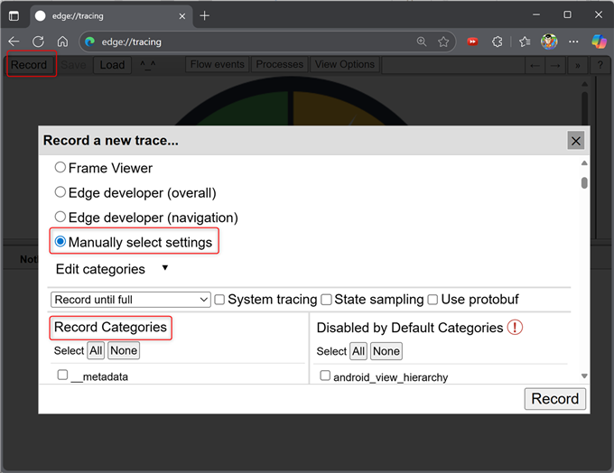
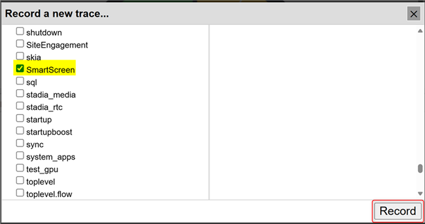
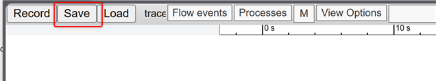
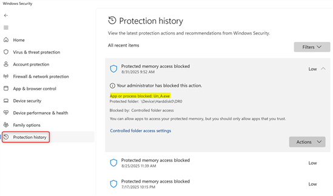

## Edge 的 SmartScreen 检查清单

### 启用 SmartScreen 调试日志

1. 以管理员身份打开 **Command Prompt**。

2. 创建输出文件夹并启用日志：

   ```bat
   if not exist "C:\Logs" mkdir "C:\Logs"
   wevtutil.exe sl "Microsoft-Windows-SmartScreen/Debug" /e:true
   ```

### 启用 Edge 跟踪

1. 打开 Edge 并转到 `edge://tracing`。

2. 选择 **Reload**，然后选择 **Manually select settings**。

   

3. 在 **Record Categories** 下，仅选择 **SmartScreen**，然后选择 **Record**。

   

### 收集日志

1. 启用 SmartScreen 调试日志和 Edge 跟踪后，复现问题。

2. 停止并保存 Edge 跟踪。

   

3. 在同一个管理员 **Command Prompt** 中导出 SmartScreen 日志：

   ```bat
   wevtutil.exe epl "Microsoft-Windows-SmartScreen/Debug" "C:\Logs\SmartScreen-Debug.evtx"
   ```

   若 `SmartScreen-Debug.evtx` 已存在，请使用新的文件名。

4. 进入 **Windows Security > Protection history**，展开相关的已阻止内容记录。

   

### 事件日志位置（参考）

在**事件查看器**中，日志位于 **Applications and Services Logs > Microsoft > Windows > SmartScreen > Debug**。若未显示，选择 **View > Show Analytic and Debug Logs**。

默认日志文件为 `%SystemRoot%\System32\Winevt\Logs\Microsoft-Windows-SmartScreen%4Debug.evtx`。
