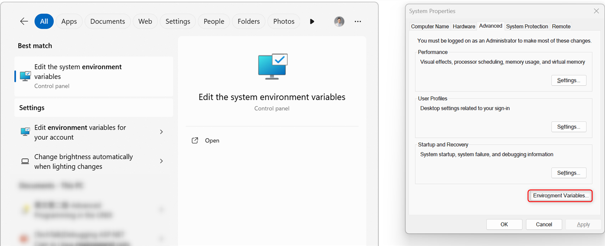
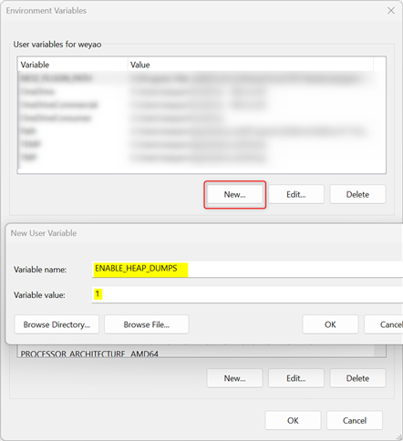
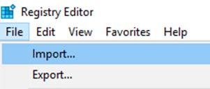
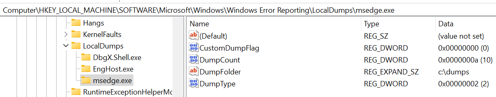

按 Edge 崩溃类型**只选择一种**方式，不是先后执行的步骤。

## 选择崩溃类型

| 崩溃类型 | 何时收集 | 章节 |
| --- | --- | --- |
| Crashpad | 标签页、渲染器或 GPU 进程崩溃，但 Edge 本身继续运行或重启 | [Crashpad 崩溃事件](#crashpad-crash-event) |
| Windows Error Reporting | 整个 `msedge.exe` 进程终止，并且 Windows 报告应用程序崩溃 | [Windows 崩溃事件](#windows-crash-event) |

## Crashpad 崩溃事件
{: #crashpad-crash-event }

1. 搜索 **Environment Variables**，然后打开。

    

2. 添加新的 **User variable**：

   - **Variable name**：`ENABLE_HEAP_DUMPS`
   - **Variable value**：`1`

    

3. 转到 `edge://settings/system`，然后关闭 **Startup boost**。

    

   {: .tip }
   > 如果此设置已禁用（灰显）且无法更改，请在提升权限的 **Command Prompt** 或 **PowerShell** 中运行以下命令：

   ```bat
   REG ADD "HKLM\SOFTWARE\Policies\Microsoft\Edge" /v StartupBoostEnabled /t REG_DWORD /d 0 /f
   ```

4. 单击 **Settings(...) > Close Microsoft Edge** 以完全退出 Edge。重新打开 Edge，然后复现问题。

5. 验证转储文件已在 `%LOCALAPPDATA%\Microsoft\Edge\User Data\Crashpad\reports` 生成。

## Windows 崩溃事件
{: #windows-crash-event }

1. 右键 [msedge-wer.reg]()，选择**链接另存为**并保存。

2. 双击 `msedge-wer.reg`，将其导入注册表。

    

3. 确认以下注册表项的值与截图一致：

   ```text
   HKLM\SOFTWARE\Microsoft\Windows\Windows Error Reporting\LocalDumps\msedge.exe
   ```

    

4. 在 `C:\dumps` 创建文件夹。

5. 复现问题。

6. 验证转储文件已在 `C:\dumps` 生成。
