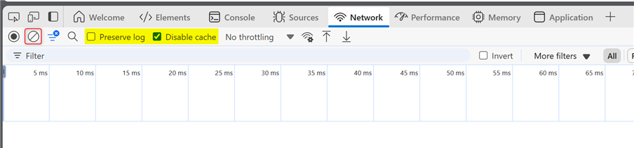
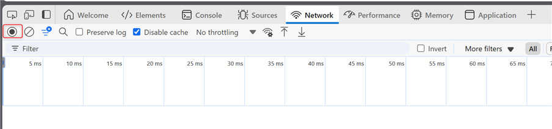
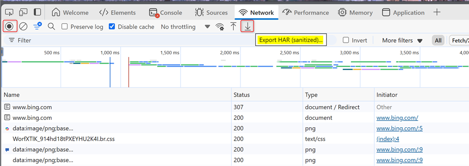

## 从 Edge Developer Tools 收集网络跟踪日志

大多数网络问题使用本指南即可。默认导出的 HAR 文件不包含 Cookie 和身份验证标头。只有支持人员明确要求时，才使用[在 HAR 文件中捕获身份验证数据]()。

1. 打开 Microsoft Edge，然后按 **F12** 打开 **Developer Tools**。

2. 选择 **Network** 选项卡。然后选择 **Clear cache** 并启用 **Disable cache**。

    

3. 选择 **Record** 开始录制，然后复现问题。

    

4. 问题复现且请求完成后，再次选择 **Record** 停止录制。然后选择 **Export HAR** 保存跟踪。

    

{: .note }
> 有关详细信息，请参阅：[https://learn.microsoft.com/en-us/azure/azure-portal/capture-browser-trace#microsoft-edge](https://learn.microsoft.com/en-us/azure/azure-portal/capture-browser-trace#microsoft-edge)
