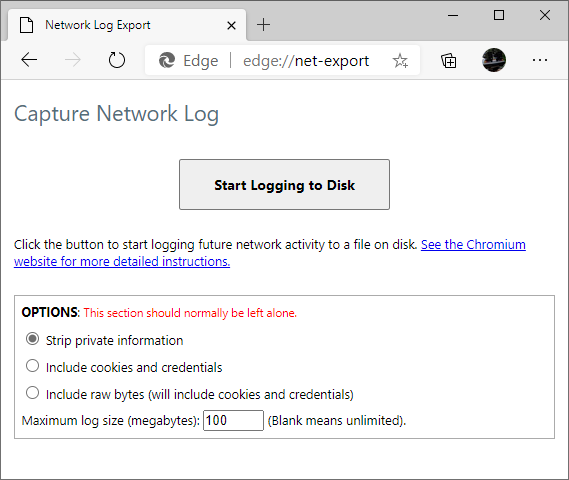
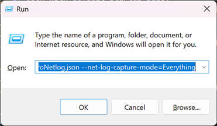

## 选择捕获方法

以下方式**只选一种**，不是先后执行的步骤。

| 捕获方法 | 使用场景 | 章节 |
| --- | --- | --- |
| 浏览器内捕获 | 问题可在 Edge 已运行后复现 | [捕获 net-export](#capture-in-browser) |
| 命令行捕获 | 问题发生在启动期间，早于你打开 `edge://net-export` 的时机 | [为启动页捕获 net-export](#capture-startup) |

## 捕获 net-export
{: #capture-in-browser }

1. 打开 Edge 并转到 `edge://net-export`。

    {: .tip }
    > 可选：关闭除一个以外的所有浏览器标签页。

2. 选择 **Start Logging to Disk**。

    

3. 选择用于保存流量日志的文件名和位置。

4. 打开新标签页并复现问题。

    {: .warning }
    > 不要关闭 `edge://net-export` 标签页。

5. 复现问题后，选择 **Stop Logging**。

## 为启动页捕获 net-export
{: #capture-startup }

1. 复制适用场景的命令：

   - 默认启动页：

     ```text
     msedge.exe --log-net-log="%USERPROFILE%\Desktop\ReproNetlog.json" --net-log-capture-mode=Everything
     ```

   - 指定启动页：

     ```text
     msedge.exe --log-net-log="%USERPROFILE%\Desktop\ReproNetlog.json" --net-log-capture-mode=Everything "https://www.bing.com"
     ```

   - InPrivate 模式：

     ```text
     msedge.exe --log-net-log="%USERPROFILE%\Desktop\ReproNetlog.json" --net-log-capture-mode=Everything --inprivate
     ```

   Chrome 使用 `--incognito`，不使用 `--inprivate`。

2. 按 **Win+R** 打开**运行**，粘贴所选命令并启动 Edge。

   

3. 复现问题，确认桌面上已生成 `ReproNetlog.json`。

## 参考

- [https://www.chromium.org/for-testers/providing-network-details/](https://www.chromium.org/for-testers/providing-network-details/)
- [https://textslashplain.com/2020/01/17/capture-network-logs-from-edge-and-chrome/](https://textslashplain.com/2020/01/17/capture-network-logs-from-edge-and-chrome/)
