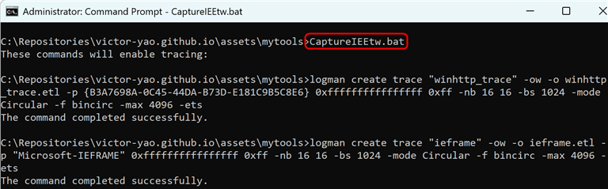
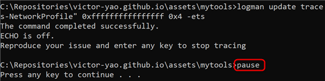
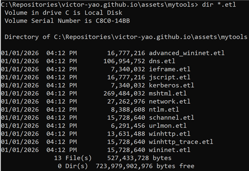

## 为 Internet Explorer 收集 ETW 跟踪

1. 新建 `C:\Temp\IE-ETW` 文件夹。右键 [CaptureIEEtw.bat]()，选择**链接另存为**，保存到该文件夹。

2. 以管理员身份打开 **Command Prompt**，进入 `C:\Temp\IE-ETW`。

3. 运行 `CaptureIEEtw.bat` 开始跟踪，等待脚本暂停。

   

4. 打开 IE 并复现问题，然后在 **Command Prompt** 中按 **Enter** 继续执行脚本。

   

5. 脚本完成后，收集当前文件夹中的 `*.etl` 文件。

   

{: .note }
> 有关更多信息，请参阅：[https://learn.microsoft.com/en-us/windows-hardware/test/wpt/event-tracing-for-windows](https://learn.microsoft.com/en-us/windows-hardware/test/wpt/event-tracing-for-windows)
