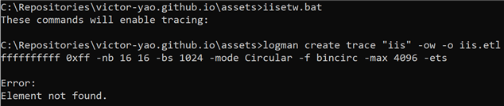
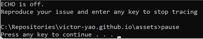
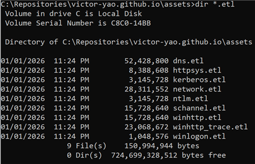

## 收集 IIS 的 Windows 事件跟踪

1. 下载 [toolkit.zip](https://github.com/Victor-Yao/victor-yao.github.io/releases/download/v0.0.0/toolkit.zip)，然后解压。

2. 以管理员身份打开 **Command Prompt**，进入解压后的 `toolkit` 文件夹。

3. 运行 `iisetw.bat` 开始跟踪，等待脚本暂停。

   

4. 复现问题，然后在 **Command Prompt** 中按 **Enter** 继续执行脚本。

   

5. 脚本完成后，收集当前文件夹中的 `*.etl` 文件。

   
