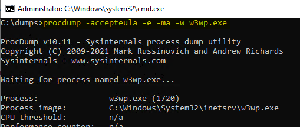
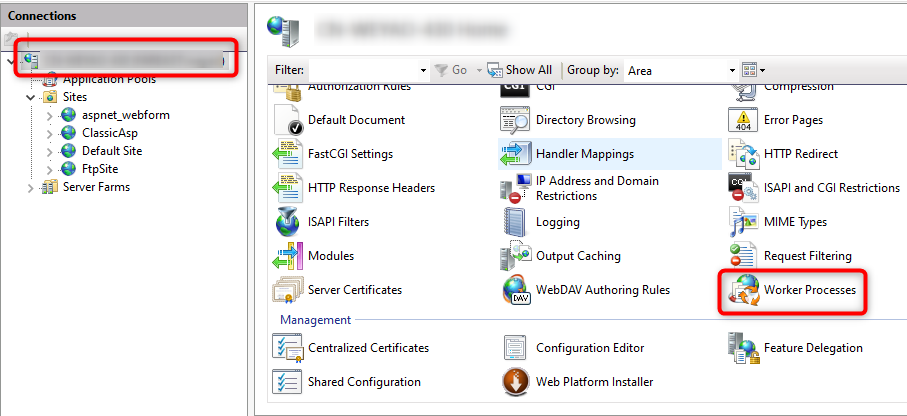
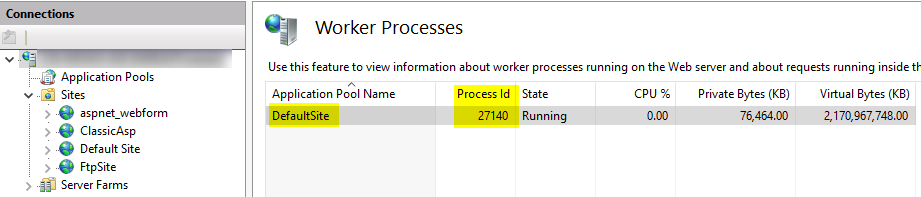
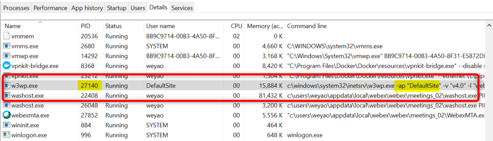

## 使用 procdump 收集 w3wp.exe 的内存转储

### 前提条件

1. 下载 [Procdump](https://download.sysinternals.com/files/Procdump.zip)。有关更多信息，请参阅 [https://learn.microsoft.com/en-us/sysinternals/downloads/procdump](https://learn.microsoft.com/en-us/sysinternals/downloads/procdump#examples)

2. 以管理员身份打开 **Command Prompt**，进入解压后的 ProcDump 文件夹。

### 选择抓取模式

以下抓取模式**只选一种**，不是先后执行的步骤。

| 抓取模式 | 使用场景 | 小节 |
| --- | --- | --- |
| 单个转储 | 需要当前进程状态的一个快照，例如挂起时 | [抓取单个转储](#single-dump) |
| 按固定间隔抓取多个转储 | 需要比较一段时间内的进程状态，例如内存泄漏 | [抓取多个转储](#interval-dumps) |
| 异常转储 | 需要抛出特定异常消息时的状态 | [抓取异常转储](#exception-dump) |
| 崩溃转储 | 需要进程意外终止时的状态 | [抓取崩溃转储](#crash-dump) |

### 抓取单个转储
{: #single-dump }

1. 完成[前提条件](#前提条件)。

2. [查找目标工作进程的 PID](#附录-1-如何查找目标-w3wpexe-进程的-pid)。

3. 将 `<pid>` 替换为目标进程 ID，然后运行：

   ```bat
   procdump -ma -accepteula <pid>
   ```

### 按固定间隔抓取多个转储
{: #interval-dumps }

1. 完成[前提条件](#前提条件)。

2. [查找目标工作进程的 PID](#附录-1-如何查找目标-w3wpexe-进程的-pid)。

3. 将 `<pid>` 替换为目标进程 ID，然后运行：

   ```bat
   procdump -ma -accepteula -s 10 -n 3 <pid>
   ```

### 抓取异常内存转储
{: #exception-dump }

1. 完成[前提条件](#前提条件)。

2. 将 `<exception-filter>` 替换为异常消息文本，然后运行：

   ```bat
   procdump -ma -n 1 -e 1 -f "<exception-filter>" w3wp.exe
   ```

   {: .tip }
   > 如果要抓取其他进程，请将 `w3wp.exe` 替换为目标进程名称（例如 `dotnet.exe`）。

### 抓取崩溃转储
{: #crash-dump }

1. 完成[前提条件](#前提条件)。

2. 运行以下命令，然后等待崩溃发生：

   ```bat
   procdump -accepteula -e -ma -w w3wp.exe
   ```

   


#### 附录 1. 如何查找目标 w3wp.exe 进程的 PID

- 选项 1：IIS Manager
   
   
- 选项 2：Task Manager
   
 