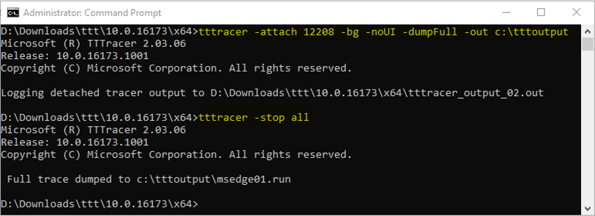

## 为 IIS 工作进程抓取 TTT 跟踪

1. 根据系统架构下载对应的 TTD，然后解压到 `C:\TTD`：

   - 64 位 Windows：[TTD_x64.zip](https://github.com/Victor-Yao/victor-yao.github.io/releases/download/ttd-1.10.91.0/TTD_x64.zip)
   - 32 位 Windows：[TTD_x86.zip](https://github.com/Victor-Yao/victor-yao.github.io/releases/download/ttd-1.10.91.0/TTD_x86.zip)

   {: .note }
   > 这是 TTD 内部版本（1.10.91.0），与公开下载的 TTD 不同。

2. 以管理员身份打开 **Command Prompt**，然后进入 `C:\TTD\TTD_x64` 或 `C:\TTD\TTD_x86`。

3. 创建目标文件夹 `c:\tttoutput` 来保存输出日志。

4. 查找 `w3wp.exe` 的 **PID**。有关指南，请参阅[查找目标 w3wp.exe 进程的 PID](/zh/docs/IIS/iisprocdump/#附录-1-如何查找目标-w3wpexe-进程的-pid)

5. 将 `<pid>` 替换为目标进程 ID，开始跟踪：

   ```bat
   tttracer -attach <pid> -bg -noUI -dumpFull -out c:\tttoutput
   ```

6. 复现问题。

7. 完成后，运行以下命令停止跟踪：

   ```bat
   tttracer -stop all
   ```

   

8. 收集 `c:\tttoutput` 中的 TTT 跟踪文件。
