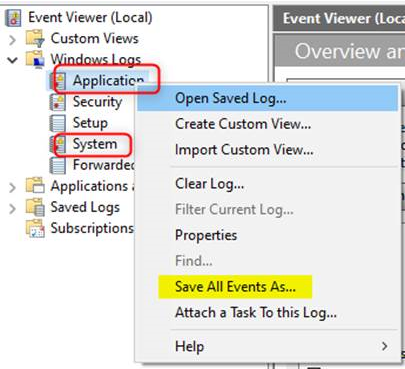
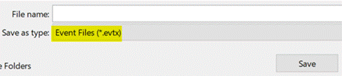

## 收集 CAPI2 日志

CAPI2 记录证书链构建和校验过程。本指南只收集 CAPI2 日志；如需 Application 和 System 日志，请参阅[导出 Windows 事件日志]()。

优先使用 PowerShell；只有在无法运行 PowerShell 命令时，才使用事件查看器。两种方式完成后，都执行相同的[收集后清理](#after-collection)步骤。

{: .important }
> 导出并验证保存的日志前，不要清空 CAPI2 事件。导出会覆盖同名文件；如需保留旧文件，请更换输出文件夹。

{: .note }
> 没有 CAPI2 错误，**不能排除所有证书问题**。

### 用 PowerShell 收集

在同一个管理员 **PowerShell** 窗口中执行以下全部步骤。

1. 创建 `C:\Logs` 文件夹。
2. 启用日志前，先保存当前的 CAPI2 设置：

   ```powershell
   $out = 'C:\Logs'
   wevtutil.exe gl 'Microsoft-Windows-CAPI2/Operational' |
       Out-File "$out\capi2-settings-before.txt" -ErrorAction Stop
   if ($LASTEXITCODE -ne 0) { throw 'Cannot read CAPI2 channel settings.' }
   ```

3. 启用 CAPI2 日志：

   ```powershell
   wevtutil.exe sl 'Microsoft-Windows-CAPI2/Operational' /e:true
   if ($LASTEXITCODE -ne 0) { throw 'Cannot enable CAPI2 logging.' }
   ```

4. 复现一次问题，记录本地时间。
5. 导出 CAPI2 事件：

   ```powershell
   wevtutil.exe epl 'Microsoft-Windows-CAPI2/Operational' "$out\CAPI2.evtx" /ow:true
   if ($LASTEXITCODE -ne 0) { throw 'Cannot export CAPI2 log.' }
   ```

6. 收集 `C:\Logs` 中的文件：

   | 文件 | 内容 |
   | --- | --- |
   | `CAPI2.evtx` | 证书链构建与校验事件 |
   | `capi2-settings-before.txt` | 启用前的通道设置，不是事件内容 |

### 改用事件查看器收集

1. 创建 `C:\Logs` 文件夹。
2. 以管理员身份打开**事件查看器（Event Viewer）**，进入 **Applications and Services Logs > Microsoft > Windows > CAPI2 > Operational**。
3. 记录日志是否已启用。
4. 如果未启用，右键 **Operational**，选择**启用日志（Enable Log）**。
5. 复现一次问题，记录本地时间。
6. 右键 **Operational**，选择**将所有事件另存为（Save All Events As...）**。

   

7. 保存类型选择 **Event Files (*.evtx)**，保存为 `C:\Logs\CAPI2.evtx`。

   

## 收集后清理
{: #after-collection }

1. 打开 `C:\Logs\CAPI2.evtx`，确认采集到所需事件；将需要保留的副本保存到批准的诊断数据位置。
2. 如果收集前日志未启用，重新禁用；原状态参照 `capi2-settings-before.txt` 或事件查看器中的记录。如果原本已启用，则保持启用。

   ```powershell
   wevtutil.exe sl 'Microsoft-Windows-CAPI2/Operational' /e:false
   if ($LASTEXITCODE -ne 0) { throw 'Cannot disable CAPI2 logging.' }
   ```

   在事件查看器中，右键 **Operational**，选择**禁用日志（Disable Log）**。

3. 可选：仅在导出验证完成、且获准删除该通道全部事件后，清空无用的 CAPI2 事件。

   {: .warning }
   > 此操作会清空 **CAPI2 Operational 的全部事件**，包括采集前的记录，并非逐条删除。如有原事件需要保留，跳过此步。

   ```powershell
   wevtutil.exe cl 'Microsoft-Windows-CAPI2/Operational'
   if ($LASTEXITCODE -ne 0) { throw 'Cannot clear CAPI2 log.' }
   ```

   在事件查看器中，右键 **Operational**，选择**清除日志（Clear Log）**。

4. 所需副本验证完成且满足保留要求后，再删除无用的导出副本和设置记录文件。

## 参考

- [wevtutil](https://learn.microsoft.com/zh-cn/windows-server/administration/windows-commands/wevtutil)
- [访问并启用 CAPI2 日志以诊断证书问题](https://learn.microsoft.com/zh-cn/troubleshoot/developer/visualstudio/installation/install-failure-2017-later-versions#enable-capi2-logs)
