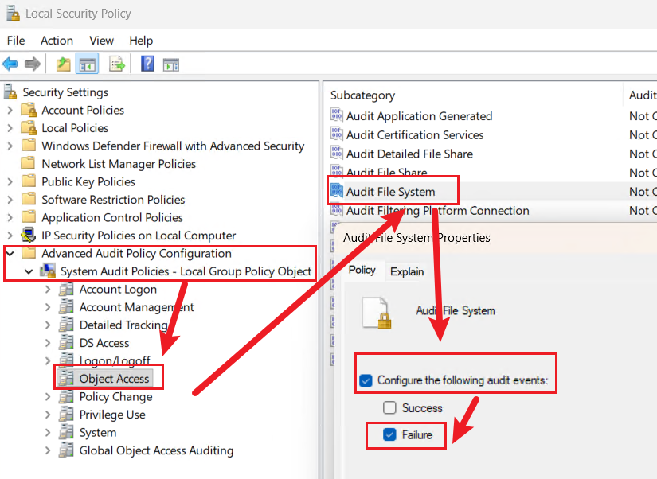
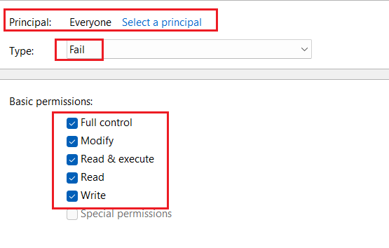
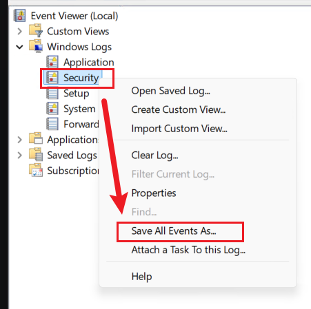

## 开始前

- **位置：** 检查文件权限的计算机，共享文件通常在文件服务器上。
- **账户：** 管理员。
- **文件：** 位于 NTFS 分区，将 `C:\App\data\example.txt` 替换为实际路径。
- **记录：** 原有审核策略和文件审核条目。

## 启用失败审核

1. 打开**本地安全策略**（`secpol.msc`）。
2. 进入**高级审核策略配置 > 系统审核策略 > 对象访问 > 审核文件系统**。
3. 勾选**配置以下审核事件（Configure the following audit events）**。
4. 勾选**失败（Failure）**，保留原有**成功（Success）**设置。

   

5. 以管理员身份打开 **Command Prompt**，运行：

   ```bat
   auditpol /get /subcategory:"{0CCE921D-69AE-11D9-BED3-505054503030}"
   ```

6. 确认结果包含**失败（Failure）**。

- 如果本地设置被域策略覆盖，联系域管理员处理。

## 添加文件审核条目

{: .important }
> 只在**审核（Auditing）**页配置，不改权限页。这里勾选“完全控制”只是选择记录的操作，**不会授予 Everyone 文件访问权限**。

1. 右键目标文件，选择**属性**。
2. 打开**安全 > 高级 > 审核（Auditing）**。
3. 单击**添加**。
4. **主体（Principal）**选择 **Everyone**。
5. **类型（Type）**选择**失败（Fail）**。
6. **基本权限（Basic permissions）**勾选**完全控制（Full control）**。

   

7. 保存新增条目。
8. 应用更改，保留已有审核条目。

**父文件夹也涉及问题时：**

- 为父文件夹添加同样的失败审核条目。
- **应用于（Applies to）**设为**仅此文件夹（This folder only）**。

## 复现并导出 Security 日志

1. 再次复现文件访问失败。
2. 记录复现时间和时区。
3. 打开**事件查看器**。
4. 选择**Windows 日志 > 安全（Security）**。
5. 右键 **Security**，选择**将所有事件另存为（Save All Events As...）**。

   

6. 将完整日志保存为 `Security.evtx`，**不要清空日志**。

## 检查与提交

1. 查找与时间、对象路径和进程匹配的 **4656 / 审核失败（Audit Failure）**。
2. 若未找到匹配记录，重新检查审核策略和文件审核条目。
3. 将 `Security.evtx` 压缩为 ZIP。
4. 附上复现时间、时区和目标路径。
5. 通过支持团队的**安全渠道**提交。

{: .note }
> **4663 没有 Failure 事件。** 并非所有文件错误都是权限拒绝。

日志可能包含账户名和路径，分享前请阅读[数据隐私须知]()。

## 恢复设置

- **仅移除本次排查新增的审核条目**。
- 恢复原有 **Failure** 设置。
- 域策略管理的设置，联系域管理员恢复。
- 保留已有审核和采集日志。

## 参考

- [审核文件系统](https://learn.microsoft.com/zh-cn/previous-versions/windows/it-pro/windows-10/security/threat-protection/auditing/audit-file-system)
- [为文件或文件夹应用审核策略](https://learn.microsoft.com/zh-cn/previous-versions/windows/it-pro/windows-10/security/threat-protection/auditing/apply-a-basic-audit-policy-on-a-file-or-folder)
- [auditpol get](https://learn.microsoft.com/zh-cn/windows-server/administration/windows-commands/auditpol-get)
- [4656：请求了对象的句柄](https://learn.microsoft.com/zh-cn/previous-versions/windows/it-pro/windows-10/security/threat-protection/auditing/event-4656)
- [4663：尝试访问对象](https://learn.microsoft.com/zh-cn/previous-versions/windows/it-pro/windows-10/security/threat-protection/auditing/event-4663)
