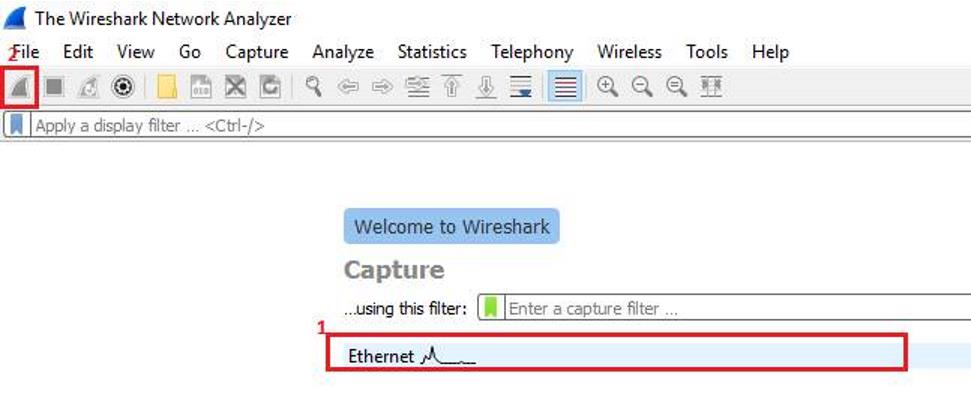
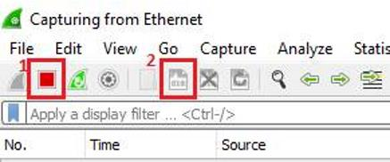

## 选择抓取方式

只选择以下**一种**方式，它们不是先后执行的步骤。

| 方式 | 适用场景 | 章节 |
| --- | --- | --- |
| netsh trace | 默认选择。Windows 自带，无需安装 | [netsh trace](#netsh-trace) |
| Network Monitor | 要求提供 `.cap` 文件，或已安装 NetMon | [Network Monitor](#netmon) |
| Wireshark | 需要实时查看数据包，并且允许安装软件 | [Wireshark](#wireshark) |

采集前创建 `c:\logs`。需要对比客户端与服务器时，在两端同时采集，并按计算机名区分保存的文件。

## netsh trace（ETW）
{: #netsh-trace }

以管理员身份打开 **PowerShell**。

1. 开始抓包，以 2048 MB 循环文件保存。

   ```powershell
   netsh trace start capture=yes tracefile=c:\logs\nettrace.etl maxsize=2048 filemode=circular overwrite=yes
   ```

2. 复现问题。
3. 停止采集，等待文件写入完成。

   ```powershell
   netsh trace stop
   ```

4. 收集 `c:\logs\nettrace.etl`；若生成 `nettrace.cab`，一并收集。

### 常用选项

以下命令可替换上方的启动命令，均使用 `netsh trace stop` 停止采集。

- **512 MB 循环文件**（覆盖最早的数据）：

  ```powershell
  netsh trace start capture=yes tracefile=c:\logs\nettrace.etl maxsize=512 filemode=circular overwrite=yes
  ```

- **按 IP 地址筛选**：

  ```powershell
  netsh trace start capture=yes IPv4.Address=10.0.0.5 tracefile=c:\logs\nettrace.etl overwrite=yes
  ```

- **仅收集 TCP**：

  ```powershell
  netsh trace start capture=yes Protocol=TCP tracefile=c:\logs\nettrace.etl overwrite=yes
  ```

- **跨重启采集**：

  ```powershell
  netsh trace start capture=yes persistent=yes tracefile=c:\logs\nettrace.etl overwrite=yes
  ```

  重启后运行 `netsh trace stop`，完成文件写入。

## Network Monitor（NetMon）
{: #netmon }

NetMon 提供 **NMCap.exe** 命令行采集工具。

1. 安装 [Microsoft Network Monitor 3.4](https://www.microsoft.com/en-us/download/details.aspx?id=4865)。
2. 以管理员身份打开 **PowerShell**，抓取所有网络接口；若安装在其他目录，修改程序路径。

   ```powershell
   & "$env:ProgramFiles\Microsoft Network Monitor 3\nmcap.exe" /network '*' /capture /file 'c:\logs\netmon.cap'
   ```

3. 保持窗口打开，复现问题。
4. 在该窗口按 **Ctrl+C**，等待 NMCap 退出。
5. 收集 `c:\logs\netmon.cap`。

## Wireshark
{: #wireshark }

1. 安装 [Wireshark](https://www.wireshark.org/download.html)。
2. 以管理员身份运行 Wireshark，选择网络接口并开始采集。

   

3. 复现问题。
4. 停止采集。

   

5. 选择 **File > Save As**，保存为 `c:\logs\wireshark.pcapng`。

## 参考

- [netsh trace](https://learn.microsoft.com/zh-cn/windows-server/administration/windows-commands/netsh-trace)
- [网络采集方法：NMCap 命令行](https://techcommunity.microsoft.com/blog/coreinfrastructureandsecurityblog/basic-network-capture-methods/258922)
- [Wireshark：开始采集](https://www.wireshark.org/docs/wsug_html_chunked/ChCapCapturingSection.html)
- [Wireshark：保存数据包](https://www.wireshark.org/docs/wsug_html_chunked/ChIOSaveSection.html)
