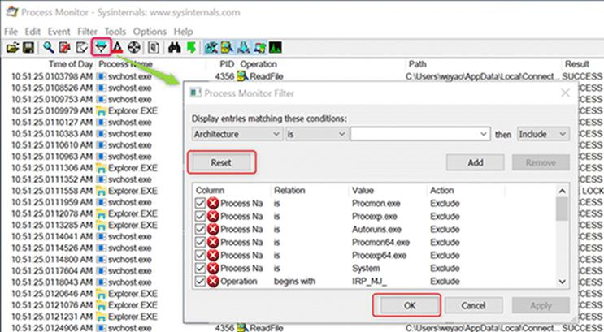
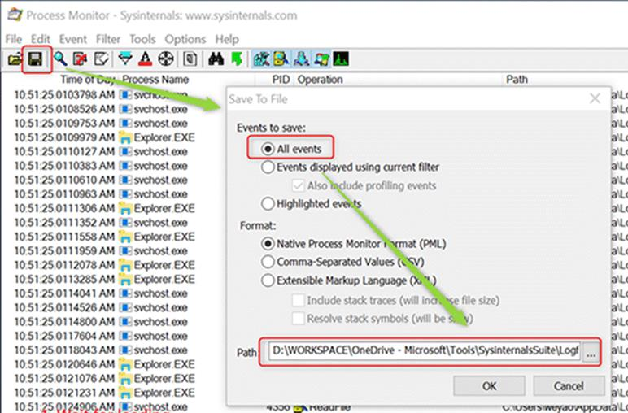
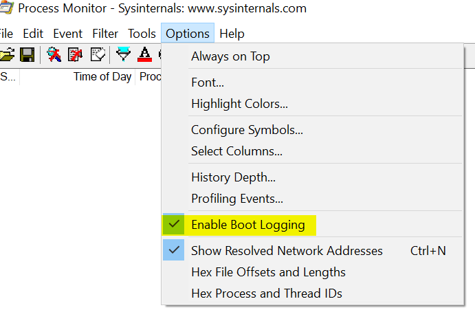

## 准备

下载并解压 [Process Monitor（Procmon）](https://learn.microsoft.com/zh-cn/sysinternals/downloads/procmon)。

下面两种采集方式**只选一种**。Windows 启动问题请改用[启动日志](#boot-logging)。

## 选择采集方式

### 普通采集
{: #normal-capture }

适用于能够较快复现的问题。以管理员身份运行 `Procmon.exe`。

### 循环采集
{: #limited-capture }

适用于需要等待的偶发问题，使用循环缓冲区保留近期事件。

1. 以管理员身份打开 **Command Prompt**，进入 `Procmon.exe` 所在文件夹。

2. 运行：

   ```bat
   Procmon.exe /AcceptEula /Minimized /Quiet /PagingFile /RingBuffer /RingBufferSize 800
   ```

`800` 表示缓冲区大小（MB），不保证导出的 PML 文件小于此值。缓冲区满后会覆盖旧事件，**不会自动停止**采集。

## 复现、停止并保存
{: #stop-and-save }

启动任一种采集方式后，执行以下步骤。

1. 打开 Procmon 窗口，按 **Ctrl+L**，选择 **Reset**，然后单击 **OK**。

   

2. 确认 **File > Capture Events** 已勾选，然后复现问题。

3. 复现后立即取消勾选 **File > Capture Events**，或按 **Ctrl+E** 停止采集。

4. 选择 **File > Save**，选中 **All events** 和 **Native Process Monitor Format (PML)**，将 `Logfile.pml` 保存到本地磁盘。

   

## 启动日志（可选）
{: #boot-logging }

需要记录 Windows 启动过程时，使用以下独立流程。

1. 以管理员身份运行 `Procmon.exe`，按上面的方式重置筛选器，然后选择 **Options > Enable Boot Logging**。

   

2. 重启 Windows 并复现问题。

3. 再次以管理员身份运行 Procmon，接受保存启动日志的提示。通过 **File > Save** 导出，选择 **All events** 和 **Native Process Monitor Format (PML)**。

4. 确认 **Options > Enable Boot Logging** 已取消勾选。

<details markdown="1">
<summary>命令行参数参考</summary>

**加粗参数**表示已用于上面的命令。尖括号内为占位符，使用前替换为实际值。

| 参数 | 用途 | 本笔记中的使用位置 |
| --- | --- | --- |
| `/OpenLog <pml-file>` | 打开已保存的 PML 文件。 | 未使用 |
| `/BackingFile <pml-file>` | 将采集事件写入指定文件。 | 未使用 |
| **`/PagingFile`** | 将采集事件保存在虚拟内存中。 | 循环采集启动 |
| `/NoConnect` | 启动时不自动采集。 | 未使用 |
| `/NoFilter` | 启动时清除筛选器，不等同于 **Reset** 恢复默认筛选器。 | 未使用 |
| **`/AcceptEula`** | 自动接受许可，不显示许可对话框。 | 循环采集启动 |
| `/LoadConfig <config-file>` | 加载预先导出的 `.pmc` 配置，包含筛选器。 | 未使用 |
| `/Profiling` | 启用线程性能分析。 | 未使用 |
| **`/Minimized`** | 最小化启动窗口。 | 循环采集启动 |
| `/WaitForIdle` | 等待 Procmon 实例就绪。 | 未使用 |
| `/Terminate` | 结束所有 Procmon 实例。 | 未使用 |
| **`/Quiet`** | 不显示启动时的筛选器确认。 | 循环采集启动 |
| `/Run32` | 在 x64 Windows 上使用 32 位版本打开 32 位日志。 | 未使用 |
| `/Runtime <seconds>` | 运行指定秒数后退出。 | 未使用 |
| `/HookRegistry` | 在 x86 Windows Vista 上使用旧版 SoftGrid 注册表挂钩模式。 | 未使用 |
| `/SaveAs <output-file>` | 配合 `/OpenLog`，将已保存日志导出为 XML、CSV 或 PML。 | 未使用 |
| `/SaveAs1 <output-file>` | 导出包含堆栈的 XML。 | 未使用 |
| `/SaveAs2 <output-file>` | 导出包含堆栈和符号的 XML。 | 未使用 |
| `/SaveApplyFilter` | 导出时应用当前筛选器。 | 未使用 |
| `/EnableBootLogging` | 启用下次 Windows 启动日志。 | 未使用；启动日志章节使用界面 |
| `/ConvertBootLog <pml-file>` | 重启后将待处理的启动日志转换为 PML。 | 未使用 |
| **`/RingBuffer`** | 启用循环采集（flight-recorder 模式）。 | 循环采集启动 |
| **`/RingBufferSize <size-mb>`** | 设置循环缓冲区大小，单位 MB。 | 循环采集启动：`800` |
| `/RingBufferLen <minutes>` | 设置循环缓冲区时长，单位分钟。 | 未使用 |
| `/Altitude <altitude>` | 设置驱动程序的数值高度。 | 未使用 |

</details>

## 参考

- [Process Monitor](https://learn.microsoft.com/zh-cn/sysinternals/downloads/procmon)
- [Microsoft Support：命令行采集、停止与保存](https://learn.microsoft.com/zh-cn/troubleshoot/windows-client/shell-experience/troubleshoot-apps-start-failure-use-process-monitor)
