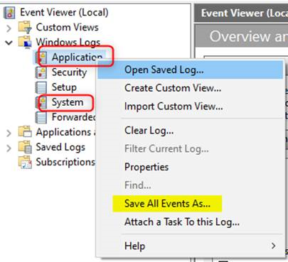
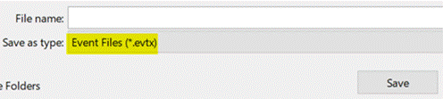

## Windows 事件日志（Application 和 System）
{: #windows-event-logs }

`C:\Logs` 须已存在且可写；在发生问题的电脑上，以管理员身份运行 PowerShell 或打开事件查看器。

{: .important }
> 不要清空原事件。命令会覆盖同名输出文件；需保留时，先更换输出目录。

### PowerShell（推荐）

```powershell
$out = 'C:\Logs'
wevtutil.exe epl Application "$out\Application.evtx" /ow:true
if ($LASTEXITCODE -ne 0) { throw 'Cannot export Application log.' }
wevtutil.exe epl System "$out\System.evtx" /ow:true
if ($LASTEXITCODE -ne 0) { throw 'Cannot export System log.' }
```

| `C:\Logs` 中的文件 | 内容 |
| --- | --- |
| `Application.evtx` | 应用程序事件 |
| `System.evtx` | 系统事件 |

### 事件查看器（备选）

1. 以管理员身份打开**事件查看器（Event Viewer）**。
2. 进入以下位置：

   ```text
   Windows Logs
     Application
     System
   ```

3. 按[通用导出步骤](#event-viewer-export-steps)，将 **Application** 保存为 `C:\Logs\Application.evtx`。
4. 按相同步骤，将 **System** 保存为 `C:\Logs\System.evtx`。

## CAPI2 日志
{: #capi2-logs }

CAPI2 用于补充证书链构建与校验线索。本指南不收集 Application 或 System。

{: .important }
> 导出并验证保存的日志前，不要清空 CAPI2 事件。导出会覆盖同名文件；需保留旧文件时，更换输出目录。

{: .note }
> 没有 CAPI2 错误，**不能排除所有证书问题**。

### PowerShell（推荐）

在同一个管理员 PowerShell 窗口中依次执行本节步骤。`C:\Logs` 须已存在且可写。

1. **保存启用前的 CAPI2 通道设置。**

   ```powershell
   $out = 'C:\Logs'
   wevtutil.exe gl 'Microsoft-Windows-CAPI2/Operational' |
       Out-File "$out\capi2-settings-before.txt" -ErrorAction Stop
   if ($LASTEXITCODE -ne 0) { throw 'Cannot read CAPI2 channel settings.' }
   ```

2. **启用 CAPI2 日志。**

   ```powershell
   wevtutil.exe sl 'Microsoft-Windows-CAPI2/Operational' /e:true
   if ($LASTEXITCODE -ne 0) { throw 'Cannot enable CAPI2 logging.' }
   ```

3. **复现一次问题，记录本地时间。**

4. **导出 CAPI2 事件。**

   ```powershell
   wevtutil.exe epl 'Microsoft-Windows-CAPI2/Operational' "$out\CAPI2.evtx" /ow:true
   if ($LASTEXITCODE -ne 0) { throw 'Cannot export CAPI2 log.' }
   ```

| `C:\Logs` 中的文件 | 内容 |
| --- | --- |
| `CAPI2.evtx` | 证书链构建与校验事件 |
| `capi2-settings-before.txt` | 启用前的通道设置，不是事件内容 |

### 事件查看器（备选）

1. 以管理员身份打开**事件查看器（Event Viewer）**。
2. 进入以下位置：

   ```text
   Applications and Services Logs
     Microsoft
       Windows
         CAPI2
           Operational
   ```

3. 记录日志是否已启用。
4. 若未启用，右键 **Operational**，选择**启用日志（Enable Log）**。
5. 复现一次问题，记录本地时间。
6. 按[通用导出步骤](#event-viewer-export-steps)，将 **Operational** 保存为 `C:\Logs\CAPI2.evtx`。

### 收集后清理
{: id="收集后清场" }

两种收集方式完成后，均按以下步骤处理。

1. 打开 `C:\Logs\CAPI2.evtx`，确认采集到所需事件；将需要保留的副本保存到批准的诊断数据位置。
2. **若收集前未启用日志，重新禁用**；原状态参照保存的设置或事件查看器记录。若原本已启用，则保持启用。

   ```powershell
   wevtutil.exe sl 'Microsoft-Windows-CAPI2/Operational' /e:false
   if ($LASTEXITCODE -ne 0) { throw 'Cannot disable CAPI2 logging.' }
   ```

   事件查看器中，右键 **Operational**，选择**禁用日志（Disable Log）**。

3. **可选：清空无用 CAPI2 事件**。仅在导出验证完成、且获准删除该通道全部事件后执行。

   {: .warning }
   > 此操作清空 **CAPI2 Operational 的全部事件**，包括采集前的记录，并非逐条删除。
   > 若有原事件需要保留，跳过此步。

   ```powershell
   wevtutil.exe cl 'Microsoft-Windows-CAPI2/Operational'
   if ($LASTEXITCODE -ne 0) { throw 'Cannot clear CAPI2 log.' }
   ```

   事件查看器中，右键 **Operational**，选择**清除日志（Clear Log）**。

4. 所需副本验证完成且保留期结束后，删除无用的导出副本和设置记录文件。

## 事件查看器通用导出步骤
{: #event-viewer-export-steps }

以下步骤仅导出各指南中选定的日志。

1. 选择需要导出的日志。
2. 右键该日志，选择**将所有事件另存为（Save All Events As...）**。

   

3. 保存为 `.evtx`，文件名参照对应指南。

   

## 参考

- [wevtutil](https://learn.microsoft.com/zh-cn/windows-server/administration/windows-commands/wevtutil)
- [访问并启用 CAPI2 日志以诊断证书问题](https://learn.microsoft.com/zh-cn/troubleshoot/developer/visualstudio/installation/install-failure-2017-later-versions#enable-capi2-logs)
