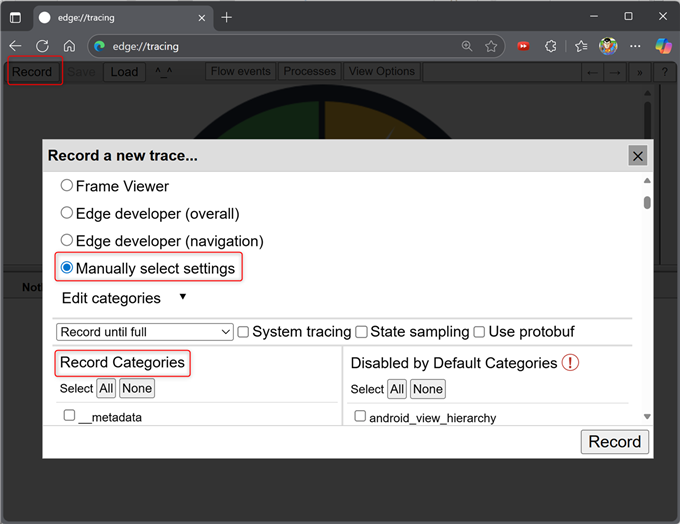
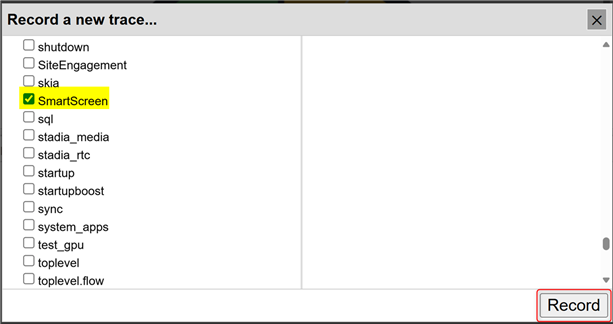
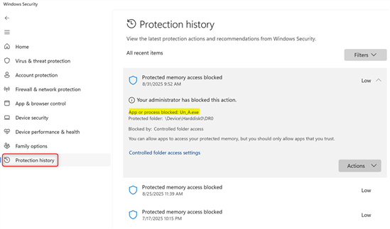

## SmartScreen checklist for Edge

### Enable the SmartScreen debug log

1. Open **Command Prompt** as an administrator.

2. Create the output folder and enable the log:

   ```bat
   if not exist "C:\Logs" mkdir "C:\Logs"
   wevtutil.exe sl "Microsoft-Windows-SmartScreen/Debug" /e:true
   ```

### Enable Edge tracing

1. Open Edge and go to `edge://tracing`.

2. Select **Reload**, then choose **Manually select settings**.

   

3. Under **Record Categories**, select **SmartScreen** only, then select **Record**.

   

### Collect logs

1. Enable the SmartScreen debug log and Edge tracing, then reproduce the issue.

2. Stop and save the Edge tracing.

   

3. In the same administrator **Command Prompt**, export the SmartScreen log:

   ```bat
   wevtutil.exe epl "Microsoft-Windows-SmartScreen/Debug" "C:\Logs\SmartScreen-Debug.evtx"
   ```

   Use a new filename if `SmartScreen-Debug.evtx` already exists.

4. Go to **Windows Security > Protection history** and expand the relevant blocked-content entries.

   

### Event log location (reference)

In **Event Viewer**, the log is under **Applications and Services Logs > Microsoft > Windows > SmartScreen > Debug**. If hidden, select **View > Show Analytic and Debug Logs**.

The default log file is `%SystemRoot%\System32\Winevt\Logs\Microsoft-Windows-SmartScreen%4Debug.evtx`.
