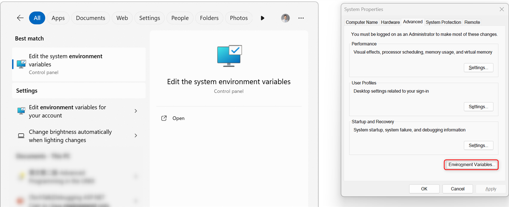
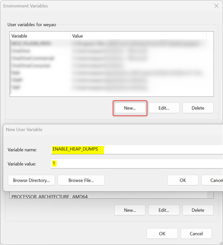
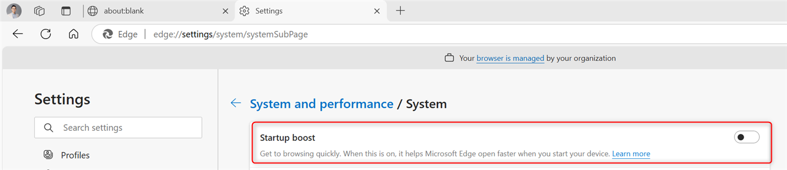
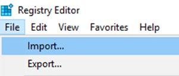
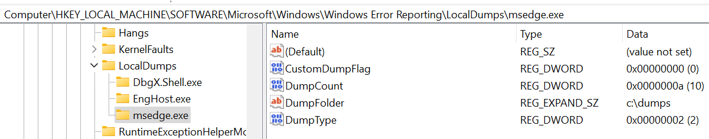

Choose **one** procedure matching the Edge crash type; these are alternatives, not sequential steps.

## Choose the crash type

| Crash type | Collect when | Section |
| --- | --- | --- |
| Crashpad | A tab, renderer, or GPU process crashes and Edge itself keeps running or restarts | [Crashpad crash event](#crashpad-crash-event) |
| Windows Error Reporting | The whole `msedge.exe` process terminates and Windows reports the application crash | [Windows crash event](#windows-crash-event) |

## Crashpad crash event
{: #crashpad-crash-event }

1. Search for **Environment Variables**, then open it.

    

2. Add a new **User variable**:

   - **Variable name:** `ENABLE_HEAP_DUMPS`
   - **Variable value:** `1`

    

3. Go to `edge://settings/system`, then turn off **Startup boost**.

    

   {: .tip }
   > If this setting is disabled (grayed out) and you cannot change it, run the following command in an elevated **Command Prompt** or **PowerShell**:

   ```bat
   REG ADD "HKLM\SOFTWARE\Policies\Microsoft\Edge" /v StartupBoostEnabled /t REG_DWORD /d 0 /f
   ```

4. Click **Settings(...) > Close Microsoft Edge** to fully exit Edge. Reopen Edge, then reproduce the issue.

5. Verify the dump file is generated at `%LOCALAPPDATA%\Microsoft\Edge\User Data\Crashpad\reports`.

## Windows crash event
{: #windows-crash-event }

1. Right-click [msedge-wer.reg](), select **Save link as**, and save it.

2. Double-click `msedge-wer.reg` to import it into the registry.

    

3. Confirm that the values under the following key match the screenshot:

   ```text
   HKLM\SOFTWARE\Microsoft\Windows\Windows Error Reporting\LocalDumps\msedge.exe
   ```

    

4. Create a folder at `C:\dumps`.

5. Reproduce the issue.

6. Verify the dump file is generated at `C:\dumps`.
