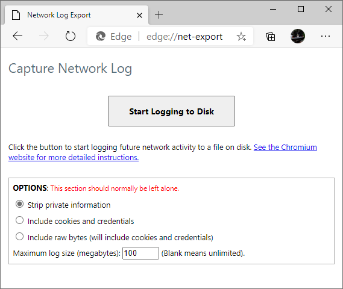
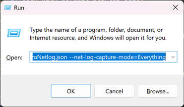

## Choose a capture method

Choose **one** method below; they are alternatives, not sequential steps.

| Capture method | Use when | Section |
| --- | --- | --- |
| In-browser capture | The issue can be reproduced after Edge is already running | [Capture net-export](#capture-in-browser) |
| Command-line capture | The issue happens during startup, before you can open `edge://net-export` | [Capture net-export for startup page](#capture-startup) |

## Capture net-export
{: #capture-in-browser }

1. Open Edge and go to `edge://net-export`.

    {: .tip }
    > Optional: Close all browser tabs except one.

2. Select **Start Logging to Disk**.

    

3. Choose a file name and location to save the traffic log.

4. Open a new tab and reproduce the issue.

    {: .warning }
    > Don't close the tab of `edge://net-export`.

5. After reproducing the issue, select **Stop Logging**.

## Capture net-export for startup page
{: #capture-startup }

1. Copy the command for your scenario:

   - Default startup page:

     ```text
     msedge.exe --log-net-log="%USERPROFILE%\Desktop\ReproNetlog.json" --net-log-capture-mode=Everything
     ```

   - Specific startup page:

     ```text
     msedge.exe --log-net-log="%USERPROFILE%\Desktop\ReproNetlog.json" --net-log-capture-mode=Everything "https://www.bing.com"
     ```

   - InPrivate mode:

     ```text
     msedge.exe --log-net-log="%USERPROFILE%\Desktop\ReproNetlog.json" --net-log-capture-mode=Everything --inprivate
     ```

   For Chrome, use `--incognito` instead of `--inprivate`.

2. Press **Win+R** to open **Run**, paste the selected command, and start Edge.

   

3. Reproduce the issue and confirm that `ReproNetlog.json` is saved to the desktop.

## References

- [https://www.chromium.org/for-testers/providing-network-details/](https://www.chromium.org/for-testers/providing-network-details/)
- [https://textslashplain.com/2020/01/17/capture-network-logs-from-edge-and-chrome/](https://textslashplain.com/2020/01/17/capture-network-logs-from-edge-and-chrome/)