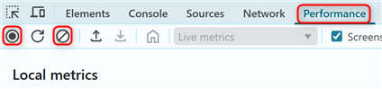
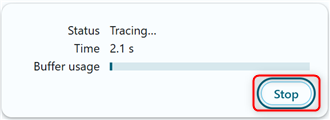
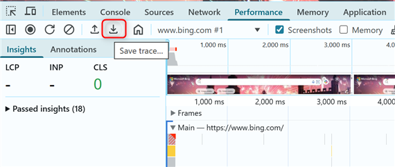

## Collect a performance recording from Edge Developer Tools

1. Open Microsoft Edge, then open **Developer Tools** by pressing **F12**.

2. Select the **Performance** tab, select **Clear**, then select **Record**.

    

3. Reproduce the issue, then select **Stop**.

    

4. Select **Save trace**.

    

{: .note }
> For more information, refer to: [https://learn.microsoft.com/en-us/microsoft-edge/devtools-guide-chromium/evaluate-performance/?source=recommendations#record-runtime-performance](https://learn.microsoft.com/en-us/microsoft-edge/devtools-guide-chromium/evaluate-performance/?source=recommendations#record-runtime-performance)
