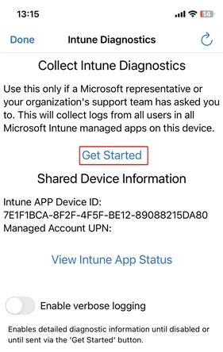
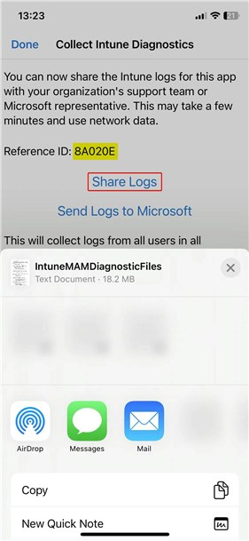

## Collect Intune help data from Edge on iOS

1. Open Microsoft Edge and reproduce the issue.

2. Go to `edge://intunehelp` and tap **Get Started**.

    

3. Copy the **Reference ID**, then tap **Share Logs** and save the logs locally.

    
