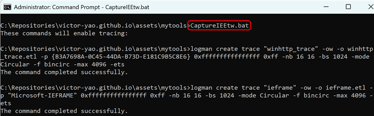
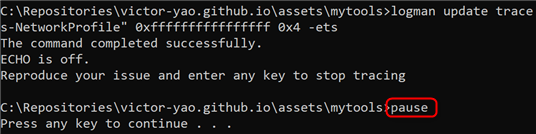
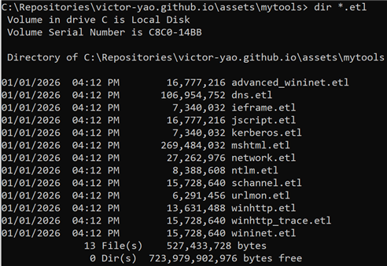

## Collect an ETW trace for Internet Explorer
{: #collect-a-etw-trace-for-internet-explorer }

1. Download [toolkit.zip](https://github.com/Victor-Yao/victor-yao.github.io/releases/download/v0.0.0/toolkit.zip), then unzip it.

2. Open **Command Prompt** as an administrator and go to the extracted `toolkit` folder.

3. Run `CaptureIEEtw.bat` to start tracing and wait for the script to pause.

   

4. Open IE and reproduce the issue, then press **Enter** in **Command Prompt** to continue the script.

   

5. When the script finishes, collect the `*.etl` files from the current folder.

   

{: .note }
> For more information, see: [https://learn.microsoft.com/en-us/windows-hardware/test/wpt/event-tracing-for-windows](https://learn.microsoft.com/en-us/windows-hardware/test/wpt/event-tracing-for-windows)