## Using DebugDiag to collect memory dump for IIS

### Prerequisites

1. Download and install [DebugDiag](https://www.microsoft.com/en-us/download/details.aspx?id=103453).

2. Run `DebugDiag.Collection.exe` as an administrator.

   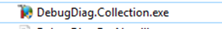

### Choose a rule type

Both options use a DebugDiag crash rule. Choose **one** for the target application pool.

| Rule type | Capture when | Section |
| --- | --- | --- |
| Crash rule | The worker process terminates unexpectedly | [Capture a crash dump](#debugdiag-crash) |
| Exception rule | A specific exception is thrown while the process keeps running | [Capture a specific exception](#debugdiag-exception) |

### Capture a crash dump
{: #debugdiag-crash }

1. Add a crash rule using the following settings:

   1. Select **Crash**.

      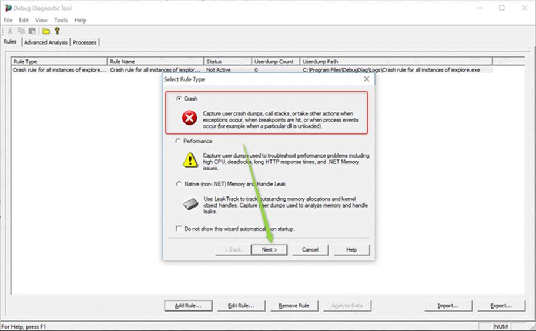

   2. Select **A specific IIS web application pool**, then continue.

      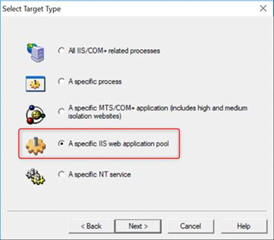

   3. Select the target application pool, then continue.

      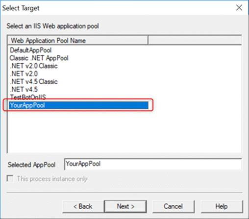

   4. Configure the advanced options as shown, then continue.

      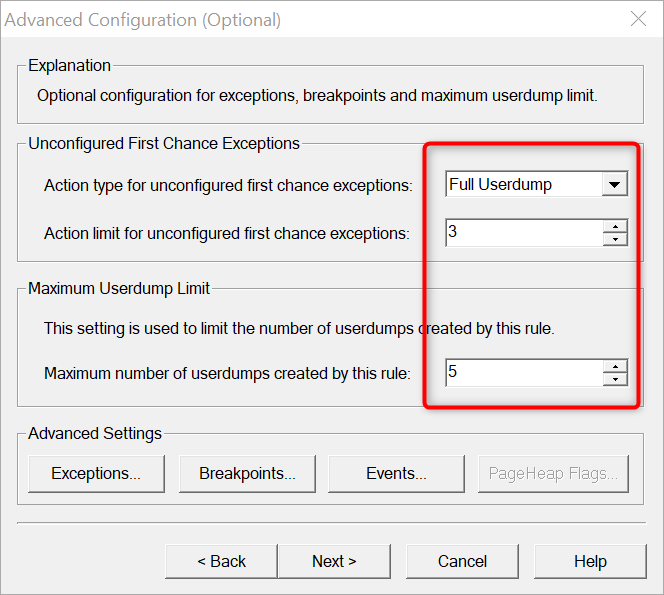

   5. Choose the dump folder, leave the default rule name, then continue.

      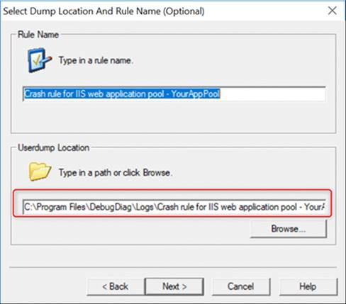

   6. Activate the rule, then finish.

      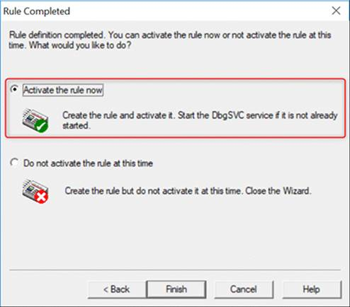

2. Wait for the crash, then confirm that a dump file was created in the selected folder.

    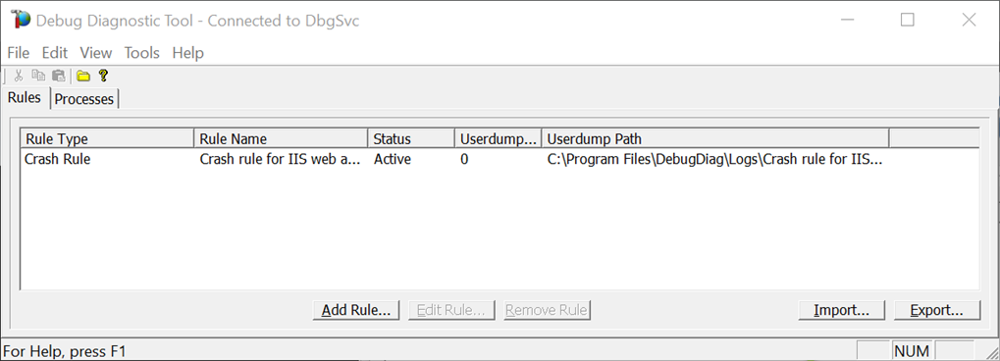

### Capture a specific exception
{: #debugdiag-exception }

1. Add a crash rule:

   1. Select **Add Rule...**.

      

   2. Select **A specific IIS web application pool**, then continue.

      

   3. Select the target application pool, then continue.

      

   4. Choose **Exceptions**, then continue.

      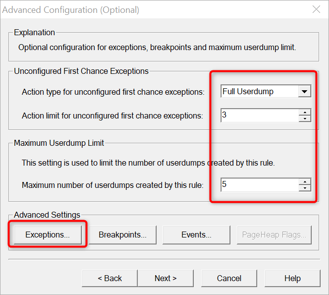

   5. Add an exception to capture, then continue.

      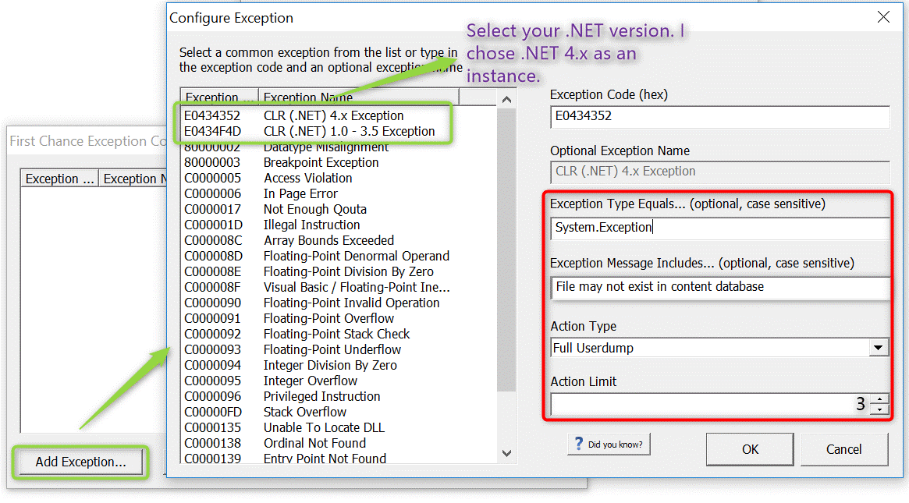

      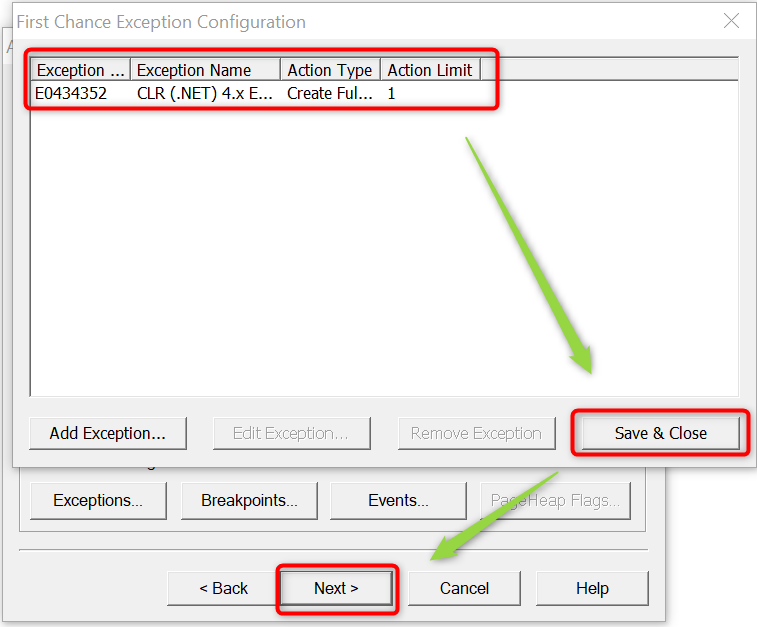

   6. Choose the dump folder, leave the default rule name, then continue.

      

   7. Activate the rule, then finish.

      

2. Wait for the exception, then confirm that a dump file was created in the selected folder.

    
