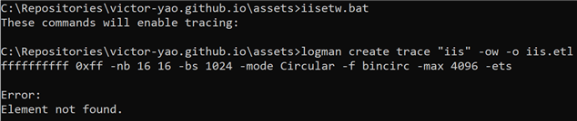
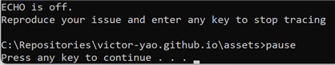
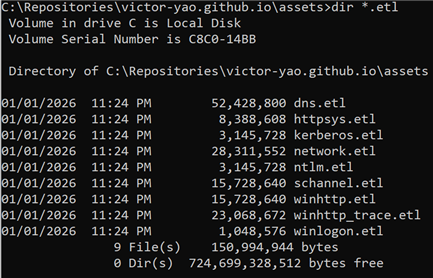

## Collect a Windows event trace for IIS

1. Download [toolkit.zip](https://github.com/Victor-Yao/victor-yao.github.io/releases/download/v0.0.0/toolkit.zip), then unzip it.

2. Open **Command Prompt** as an administrator and go to the extracted `toolkit` folder.

3. Run `iisetw.bat` to start tracing and wait for the script to pause.

   

4. Reproduce the issue, then press **Enter** in **Command Prompt** to continue the script.

   

5. When the script finishes, collect the `*.etl` files from the current folder.

   
