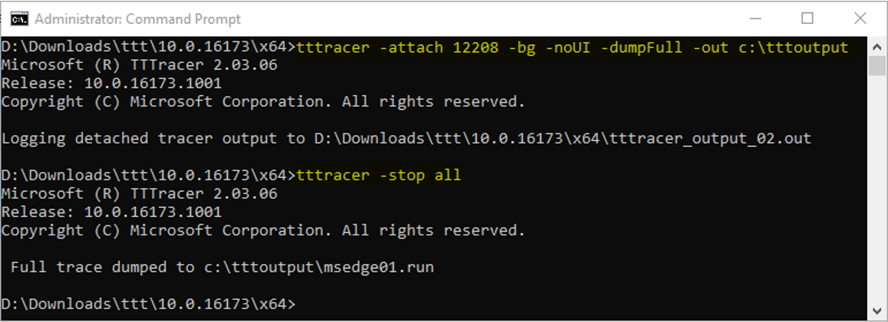

## Capture a TTT trace for IIS worker process

1. Download the TTD build for your system architecture, then extract it to `C:\TTD`:

   - 64-bit Windows: [TTD_x64.zip](https://github.com/Victor-Yao/victor-yao.github.io/releases/download/ttd-1.10.91.0/TTD_x64.zip)
   - 32-bit Windows: [TTD_x86.zip](https://github.com/Victor-Yao/victor-yao.github.io/releases/download/ttd-1.10.91.0/TTD_x86.zip)

   {: .note }
   > This is an internal TTD build (1.10.91.0) that differs from the public TTD download.

2. Open **Command Prompt** as an administrator, then go to `C:\TTD\TTD_x64` or `C:\TTD\TTD_x86`.

3. Create a destination folder `c:\tttoutput` to save the output logs.

4. Find the **PID** of `w3wp.exe`. For guides, see [Find the PID of the target w3wp.exe process](/docs/IIS/iisprocdump/#appendix-1-how-to-find-the-pid-of-the-target-w3wpexe-process)

5. Replace `<pid>` with the target process ID and start tracing:

   ```bat
   tttracer -attach <pid> -bg -noUI -dumpFull -out c:\tttoutput
   ```

6. Reproduce the issue.

7. Once done, stop the trace by running:

   ```bat
   tttracer -stop all
   ```

   

8. Collect the TTT trace files from `c:\tttoutput`.
