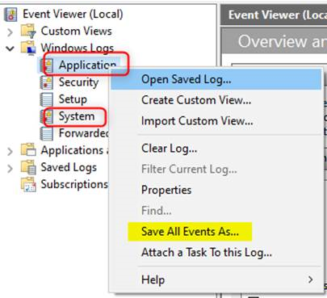
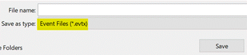

## Collect CAPI2 logs

CAPI2 records certificate chain building and validation. This guide collects only the CAPI2 log; for the Application and System logs, see [Export Windows Event Logs]().

Use PowerShell. Use Event Viewer only if you cannot run PowerShell commands. Both methods end with the same [cleanup steps](#after-collection).

{: .important }
> Do not clear CAPI2 events before exporting and verifying the saved log. The export overwrites files with the same name; use a different output folder if existing files must be retained.

{: .note }
> No CAPI2 errors does **not** rule out every certificate problem.

### Collect with PowerShell

Run all steps in the same administrator **PowerShell** window.

1. Create the `C:\Logs` folder.
2. Save the current CAPI2 settings before enabling logging:

   ```powershell
   $out = 'C:\Logs'
   wevtutil.exe gl 'Microsoft-Windows-CAPI2/Operational' |
       Out-File "$out\capi2-settings-before.txt" -ErrorAction Stop
   if ($LASTEXITCODE -ne 0) { throw 'Cannot read CAPI2 channel settings.' }
   ```

3. Enable CAPI2 logging:

   ```powershell
   wevtutil.exe sl 'Microsoft-Windows-CAPI2/Operational' /e:true
   if ($LASTEXITCODE -ne 0) { throw 'Cannot enable CAPI2 logging.' }
   ```

4. Reproduce the issue once and record the local time.
5. Export the CAPI2 events:

   ```powershell
   wevtutil.exe epl 'Microsoft-Windows-CAPI2/Operational' "$out\CAPI2.evtx" /ow:true
   if ($LASTEXITCODE -ne 0) { throw 'Cannot export CAPI2 log.' }
   ```

6. Collect the files from `C:\Logs`:

   | File | Contents |
   | --- | --- |
   | `CAPI2.evtx` | Certificate chain building and validation events |
   | `capi2-settings-before.txt` | Previous channel settings, not event contents |

### Collect with Event Viewer instead

1. Create the `C:\Logs` folder.
2. Open **Event Viewer** as an administrator, then go to **Applications and Services Logs > Microsoft > Windows > CAPI2 > Operational**.
3. Record whether the log is enabled.
4. If it is disabled, right-click **Operational** and select **Enable Log**.
5. Reproduce the issue once and record the local time.
6. Right-click **Operational**, then select **Save All Events As...**.

   

7. Save it as `C:\Logs\CAPI2.evtx` with the **Event Files (*.evtx)** type.

   

## After collection
{: #after-collection }

1. Open `C:\Logs\CAPI2.evtx` and verify the collected events.
2. Disable logging if it was originally disabled, as recorded in `capi2-settings-before.txt` or in Event Viewer. If it was already enabled before collection, leave it enabled.

   ```powershell
   wevtutil.exe sl 'Microsoft-Windows-CAPI2/Operational' /e:false
   if ($LASTEXITCODE -ne 0) { throw 'Cannot disable CAPI2 logging.' }
   ```

   In Event Viewer, right-click **Operational** and select **Disable Log**.

3. Optional: clear unneeded CAPI2 events only after verifying the export and obtaining approval to delete all events in this channel.

   {: .warning }
   > This clears **all CAPI2 Operational events**, including those from before collection; it does not delete individual records. Skip this step if any existing events must be retained.

   ```powershell
   wevtutil.exe cl 'Microsoft-Windows-CAPI2/Operational'
   if ($LASTEXITCODE -ne 0) { throw 'Cannot clear CAPI2 log.' }
   ```

   In Event Viewer, right-click **Operational** and select **Clear Log**.

## References

- [wevtutil](https://learn.microsoft.com/en-us/windows-server/administration/windows-commands/wevtutil)
- [Access and enable CAPI2 logs for certificate diagnostics](https://learn.microsoft.com/en-us/troubleshoot/developer/visualstudio/installation/install-failure-2017-later-versions#enable-capi2-logs)
