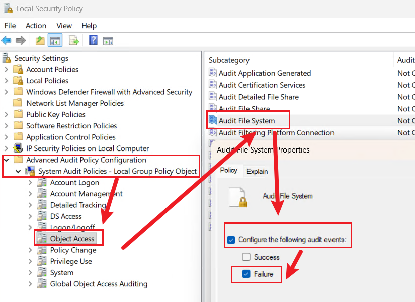
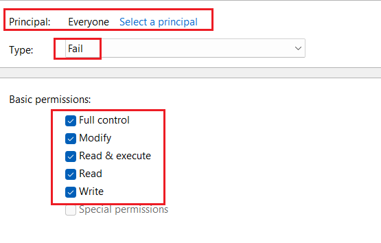
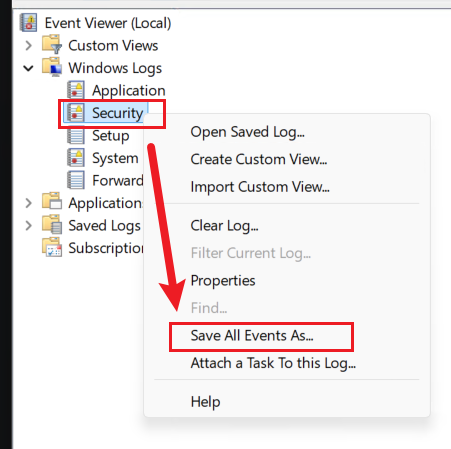

## Before you start

- **Computer:** The machine checking file permissions; usually the file server for a share.
- **Account:** Administrator.
- **File:** On NTFS. Replace `C:\App\data\example.txt` with the affected path.
- **Record:** The original audit policy and file audit entries.

## Enable failure auditing

1. Open **Local Security Policy** (`secpol.msc`).
2. Go to **Advanced Audit Policy Configuration > System Audit Policies > Object Access > Audit File System**.
3. Select **Configure the following audit events**.
4. Enable **Failure**. Leave the existing **Success** setting unchanged.

   

5. Open **Command Prompt** as an administrator and run:

   ```bat
   auditpol /get /subcategory:"{0CCE921D-69AE-11D9-BED3-505054503030}"
   ```

6. Confirm that the result includes **Failure**.

- If domain policy overrides the local setting, contact the domain administrator.

## Add a file audit entry

{: .important }
> Use **Auditing**, not Permissions. Full control here selects what to log; it does **not** grant Everyone file access.

1. Right-click the affected file and select **Properties**.
2. Open **Security > Advanced > Auditing**.
3. Select **Add**.
4. Set **Principal** to **Everyone**.
5. Set **Type** to **Fail**.
6. Select **Basic permissions > Full control**.

   

7. Save the new entry.
8. Apply the changes without removing existing audit entries.

**Parent folder, if needed:**

- Add the same failure entry to the affected parent folder.
- Set **Applies to** to **This folder only**.

## Reproduce and export the Security log

1. Reproduce the failed file access.
2. Record the reproduction time and time zone.
3. Open **Event Viewer**.
4. Select **Windows Logs > Security**.
5. Right-click **Security** and select **Save All Events As...**.

   

6. Save the complete log as `Security.evtx`. **Do not clear the log.**

## Check and submit

1. Find **4656 / Audit Failure** matching the time, object path, and process.
2. If none match, recheck the audit policy and file audit entry.
3. Compress `Security.evtx` into a ZIP file.
4. Include the reproduction time, time zone, and affected path.
5. Submit through your support team's **secure channel**.

{: .note }
> **4663 has no Failure events.** Not every file error is a permission denial.

Logs can contain account names and paths. Review the [data privacy guidance]() before sharing.

## Restore settings

- Remove **only the audit entries added for this investigation**.
- Restore the original **Failure** setting.
- Contact the domain administrator for domain-managed changes.
- Keep pre-existing auditing and the collected logs.

## References

- [Audit File System](https://learn.microsoft.com/en-us/previous-versions/windows/it-pro/windows-10/security/threat-protection/auditing/audit-file-system)
- [Apply an audit policy to a file or folder](https://learn.microsoft.com/en-us/previous-versions/windows/it-pro/windows-10/security/threat-protection/auditing/apply-a-basic-audit-policy-on-a-file-or-folder)
- [auditpol get](https://learn.microsoft.com/en-us/windows-server/administration/windows-commands/auditpol-get)
- [Event 4656: A handle to an object was requested](https://learn.microsoft.com/en-us/previous-versions/windows/it-pro/windows-10/security/threat-protection/auditing/event-4656)
- [Event 4663: An attempt was made to access an object](https://learn.microsoft.com/en-us/previous-versions/windows/it-pro/windows-10/security/threat-protection/auditing/event-4663)
