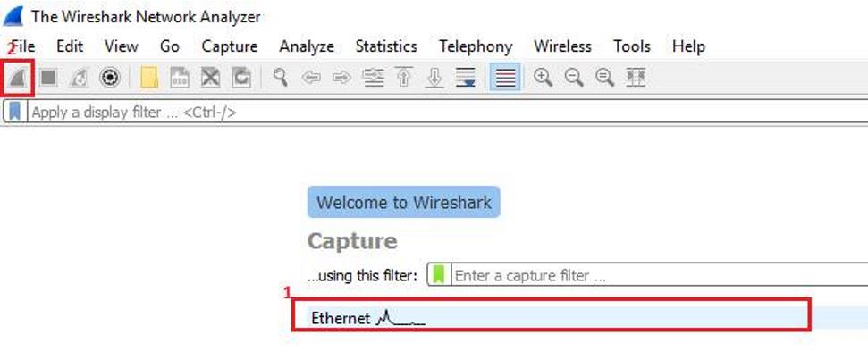
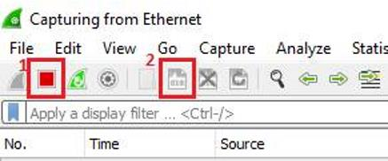

## Choose a capture method

Choose **one** method below; they are alternatives, not sequential steps.

| Method | Use when | Section |
| --- | --- | --- |
| netsh trace | Default choice. Built into Windows, no installation needed | [netsh trace](#netsh-trace) |
| Network Monitor | You are asked for a `.cap` file, or NetMon is already installed | [Network Monitor](#netmon) |
| Wireshark | You need to watch packets live, and installing software is allowed | [Wireshark](#wireshark) |

Create `c:\logs` before capture. For client/server comparison, capture on both computers at the same time and name the saved files by computer.

## netsh trace (ETW)
{: #netsh-trace }

Open **PowerShell** as an administrator.

1. Start capturing packets into a 2048 MB circular trace.

   ```powershell
   netsh trace start capture=yes tracefile=c:\logs\nettrace.etl maxsize=2048 filemode=circular overwrite=yes
   ```

2. Reproduce the issue.
3. Stop capture and wait for the files to finish writing.

   ```powershell
   netsh trace stop
   ```

4. Collect `c:\logs\nettrace.etl` and `nettrace.cab` if generated.

### Common options

Use one of these start commands instead of the command above.
Stop with `netsh trace stop`.

- **512 MB circular trace** (oldest data is overwritten):

  ```powershell
  netsh trace start capture=yes tracefile=c:\logs\nettrace.etl maxsize=512 filemode=circular overwrite=yes
  ```

- **Filter by IP address**:

  ```powershell
  netsh trace start capture=yes IPv4.Address=10.0.0.5 tracefile=c:\logs\nettrace.etl overwrite=yes
  ```

- **Filter by TCP**:

  ```powershell
  netsh trace start capture=yes Protocol=TCP tracefile=c:\logs\nettrace.etl overwrite=yes
  ```

- **Continue across a reboot**:

  ```powershell
  netsh trace start capture=yes persistent=yes tracefile=c:\logs\nettrace.etl overwrite=yes
  ```

  After reboot, run `netsh trace stop` to finalize the files.

## Network Monitor (NetMon)
{: #netmon }

NetMon provides **NMCap.exe** for command-line capture.

1. Install [Microsoft Network Monitor 3.4](https://www.microsoft.com/en-us/download/details.aspx?id=4865).
2. Open **PowerShell** as an administrator and capture all network interfaces.
   Adjust the executable path if installed elsewhere.

   ```powershell
   & "$env:ProgramFiles\Microsoft Network Monitor 3\nmcap.exe" /network '*' /capture /file 'c:\logs\netmon.cap'
   ```

3. Keep the window open and reproduce the issue.
4. Press **Ctrl+C** in that window, then wait for NMCap to exit.
5. Collect `c:\logs\netmon.cap`.

## Wireshark
{: #wireshark }

1. Install [Wireshark](https://www.wireshark.org/download.html).
2. Run Wireshark as an administrator, select the network interface, and start capture.

   

3. Reproduce the issue.
4. Stop capture.

   

5. Use **File > Save As** to save the trace as `c:\logs\wireshark.pcapng`.

## References

- [netsh trace](https://learn.microsoft.com/en-us/windows-server/administration/windows-commands/netsh-trace)
- [Basic network capture methods: NMCap command line](https://techcommunity.microsoft.com/blog/coreinfrastructureandsecurityblog/basic-network-capture-methods/258922)
- [Wireshark: start capturing](https://www.wireshark.org/docs/wsug_html_chunked/ChCapCapturingSection.html)
- [Wireshark: save captured packets](https://www.wireshark.org/docs/wsug_html_chunked/ChIOSaveSection.html)
