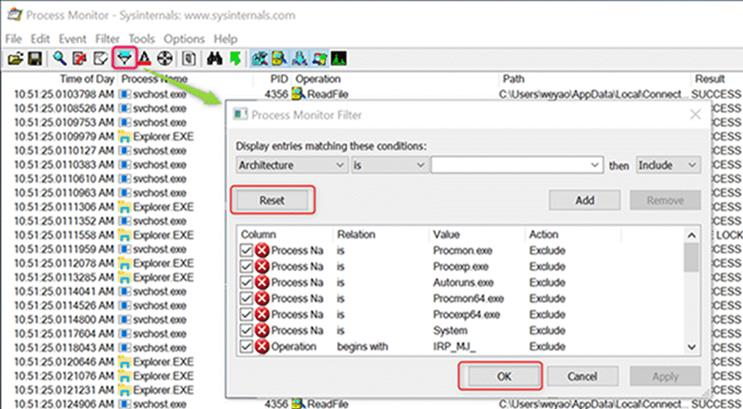
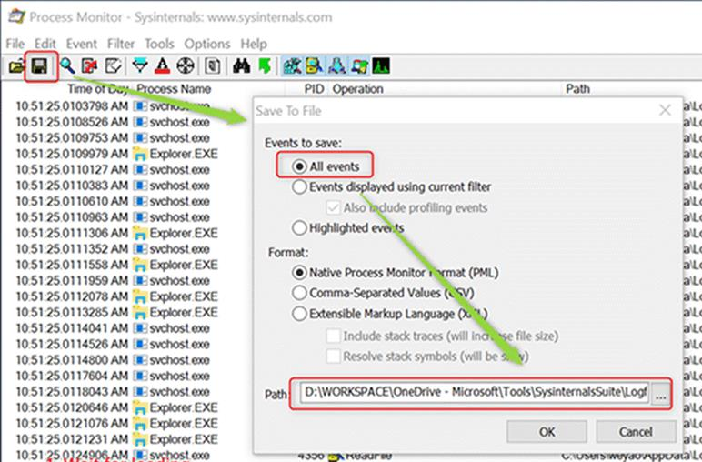
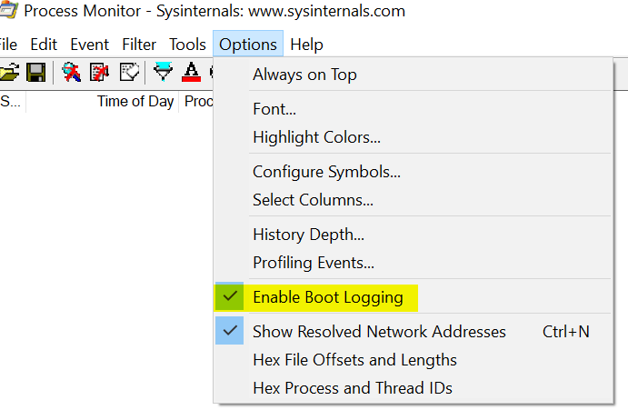

## Preparation

Download and extract [Process Monitor (Procmon)](https://learn.microsoft.com/en-us/sysinternals/downloads/procmon).

Choose **one** capture method below. For Windows startup issues, use [Boot Logging](#boot-logging) instead.

## Choose a capture method

### Normal capture
{: #normal-capture }

For issues you can reproduce quickly, run `Procmon.exe` as an administrator.

### Circular capture
{: #limited-capture }

For intermittent issues, use a circular buffer to retain recent events.

1. Open **Command Prompt** as an administrator and go to the folder containing `Procmon.exe`.

2. Run:

   ```bat
   Procmon.exe /AcceptEula /Minimized /Quiet /PagingFile /RingBuffer /RingBufferSize 800
   ```

`800` sets the buffer size in MB, not a guaranteed size limit for the exported PML file. When the buffer fills, new events overwrite old ones; capture does **not** stop automatically.

## Reproduce, stop, and save
{: #stop-and-save }

Use these steps after starting either capture method.

1. Restore the Procmon window. Press **Ctrl+L**, select **Reset**, then **OK**.

   

2. Make sure **File > Capture Events** is checked, then reproduce the issue.

3. Immediately stop capture by clearing **File > Capture Events** or pressing **Ctrl+E**.

4. Select **File > Save**, choose **All events** and **Native Process Monitor Format (PML)**, and save `Logfile.pml` to a local disk.

   

## Boot Logging (optional)
{: #boot-logging }

Use this separate procedure when you need to capture activity during Windows startup.

1. Run `Procmon.exe` as an administrator, reset the filter as shown above, then select **Options > Enable Boot Logging**.

   

2. Restart Windows and reproduce the issue.

3. Run Procmon as an administrator again and accept the prompt to save the boot log. Export it through **File > Save**, using **All events** and **Native Process Monitor Format (PML)**.

4. Make sure **Options > Enable Boot Logging** is no longer checked.

<details markdown="1">
<summary>Command-line arguments reference</summary>

**Bold arguments** are used in the commands above. Angle-bracket values are placeholders; replace them before use.

| Argument | Purpose | Used in this guide |
| --- | --- | --- |
| `/OpenLog <pml-file>` | Open a saved PML file. | Not used |
| `/BackingFile <pml-file>` | Write captured events to the specified backing file. | Not used |
| **`/PagingFile`** | Store captured events in virtual memory. | Circular startup |
| `/NoConnect` | Start without automatically capturing events. | Not used |
| `/NoFilter` | Clear filters at startup; does not restore the default filter set like **Reset**. | Not used |
| **`/AcceptEula`** | Accept the license without displaying its dialog. | Circular startup |
| `/LoadConfig <config-file>` | Load a previously exported `.pmc` configuration, including filters. | Not used |
| `/Profiling` | Enable thread profiling. | Not used |
| **`/Minimized`** | Start with the window minimized. | Circular startup |
| `/WaitForIdle` | Wait until a Procmon instance is ready. | Not used |
| `/Terminate` | End all Procmon instances. | Not used |
| **`/Quiet`** | Suppress the startup filter confirmation. | Circular startup |
| `/Run32` | Use the 32-bit version to open 32-bit logs on x64 Windows. | Not used |
| `/Runtime <seconds>` | Run for the specified time, then exit. | Not used |
| `/HookRegistry` | Use the legacy SoftGrid registry-hooking mode on x86 Windows Vista. | Not used |
| `/SaveAs <output-file>` | Export a saved log to XML, CSV, or PML; use with `/OpenLog`. | Not used |
| `/SaveAs1 <output-file>` | Export XML with stack traces. | Not used |
| `/SaveAs2 <output-file>` | Export XML with stack traces and symbols. | Not used |
| `/SaveApplyFilter` | Apply the current filter when exporting. | Not used |
| `/EnableBootLogging` | Enable logging for the next Windows startup. | Not used; boot section uses the UI |
| `/ConvertBootLog <pml-file>` | Convert a pending boot log to PML after restarting. | Not used |
| **`/RingBuffer`** | Enable circular (flight-recorder) capture. | Circular startup |
| **`/RingBufferSize <size-mb>`** | Set the circular buffer size in MB. | Circular startup: `800` |
| `/RingBufferLen <minutes>` | Set the circular buffer duration in minutes. | Not used |
| `/Altitude <altitude>` | Set the driver's numeric altitude. | Not used |

</details>

## References

- [Process Monitor](https://learn.microsoft.com/en-us/sysinternals/downloads/procmon)
- [Microsoft Support: command-line capture, termination, and saving](https://learn.microsoft.com/en-us/troubleshoot/windows-client/shell-experience/troubleshoot-apps-start-failure-use-process-monitor)