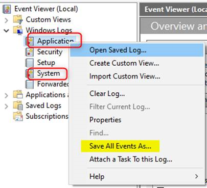
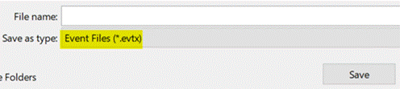

## Windows event logs (Application and System)
{: #windows-event-logs }

`C:\Logs` must already exist and be writable. Run PowerShell or open Event Viewer
as an administrator on the affected computer.

{: .important }
> Do not clear existing events. The commands overwrite files with the same name;
> use a different output directory if those files must be retained.

### PowerShell (recommended)

```powershell
$out = 'C:\Logs'
wevtutil.exe epl Application "$out\Application.evtx" /ow:true
if ($LASTEXITCODE -ne 0) { throw 'Cannot export Application log.' }
wevtutil.exe epl System "$out\System.evtx" /ow:true
if ($LASTEXITCODE -ne 0) { throw 'Cannot export System log.' }
```

| File in `C:\Logs` | Contents |
| --- | --- |
| `Application.evtx` | Application events |
| `System.evtx` | System events |

### Event Viewer (alternative)

1. Open **Event Viewer** as an administrator.
2. Navigate to:

   ```text
   Windows Logs
     Application
     System
   ```

3. Export **Application** as `C:\Logs\Application.evtx` using the
   [shared export steps](#event-viewer-export-steps).
4. Export **System** as `C:\Logs\System.evtx` using the same steps.

## CAPI2 logs
{: #capi2-logs }

CAPI2 provides evidence about certificate chain building and validation.
This guide does not collect Application or System.

{: .important }
> Do not clear CAPI2 events before exporting and verifying the saved log.
> Exports overwrite files with the same name;
> change the output directory if existing files must be retained.

{: .note }
> No CAPI2 errors does **not** rule out every certificate problem.

### PowerShell (recommended)

Run this guide's steps in the same administrator PowerShell window.
`C:\Logs` must already exist and be writable.

1. **Save the CAPI2 settings before enabling logging.**

   ```powershell
   $out = 'C:\Logs'
   wevtutil.exe gl 'Microsoft-Windows-CAPI2/Operational' |
       Out-File "$out\capi2-settings-before.txt" -ErrorAction Stop
   if ($LASTEXITCODE -ne 0) { throw 'Cannot read CAPI2 channel settings.' }
   ```

2. **Enable CAPI2 logging.**

   ```powershell
   wevtutil.exe sl 'Microsoft-Windows-CAPI2/Operational' /e:true
   if ($LASTEXITCODE -ne 0) { throw 'Cannot enable CAPI2 logging.' }
   ```

3. **Reproduce the issue once and record the local time.**

4. **Export CAPI2 events.**

   ```powershell
   wevtutil.exe epl 'Microsoft-Windows-CAPI2/Operational' "$out\CAPI2.evtx" /ow:true
   if ($LASTEXITCODE -ne 0) { throw 'Cannot export CAPI2 log.' }
   ```

| File in `C:\Logs` | Contents |
| --- | --- |
| `CAPI2.evtx` | Certificate chain building and validation events |
| `capi2-settings-before.txt` | Previous channel settings, not event contents |

### Event Viewer (alternative)

1. Open **Event Viewer** as an administrator.
2. Navigate to:

   ```text
   Applications and Services Logs
     Microsoft
       Windows
         CAPI2
           Operational
   ```

3. Record whether the log is enabled.
4. If disabled, right-click **Operational** and select **Enable Log**.
5. Reproduce once and record the local time.
6. Export **Operational** as `C:\Logs\CAPI2.evtx` using the
   [shared export steps](#event-viewer-export-steps).

### After collection

Use these steps after either collection method.

1. Open `C:\Logs\CAPI2.evtx` and verify the collected events. Save any required copy
   to the approved diagnostic-data location.
2. **Disable logging if it was originally disabled**, as recorded in the saved
   settings or Event Viewer. If already enabled before capture, leave it enabled.

   ```powershell
   wevtutil.exe sl 'Microsoft-Windows-CAPI2/Operational' /e:false
   if ($LASTEXITCODE -ne 0) { throw 'Cannot disable CAPI2 logging.' }
   ```

   In Event Viewer, right-click **Operational** and select **Disable Log**.

3. **Optionally clear unneeded CAPI2 events** only after verifying the export
   and obtaining approval to delete all events in this channel.

   {: .warning }
   > This clears **all CAPI2 Operational events**, including those from before
   > collection; it does not selectively delete individual records.
   > Skip this step if any existing events must be retained.

   ```powershell
   wevtutil.exe cl 'Microsoft-Windows-CAPI2/Operational'
   if ($LASTEXITCODE -ne 0) { throw 'Cannot clear CAPI2 log.' }
   ```

   In Event Viewer, right-click **Operational** and select **Clear Log**.

4. Remove unneeded exported copies and the saved settings file only after
   verifying the required copy and meeting the retention policy.

## Event Viewer export steps (shared)
{: #event-viewer-export-steps }

These steps apply only to the log selected in either guide.

1. Select the log to export.
2. Right-click it and select **Save All Events As...**.

   

3. Save as `.evtx`, using the filename from the relevant guide.

   

## References

- [wevtutil](https://learn.microsoft.com/en-us/windows-server/administration/windows-commands/wevtutil)
- [Access and enable CAPI2 logs for certificate diagnostics](https://learn.microsoft.com/en-us/troubleshoot/developer/visualstudio/installation/install-failure-2017-later-versions#enable-capi2-logs)